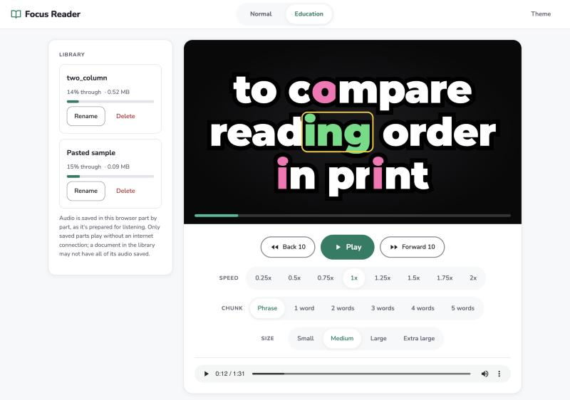
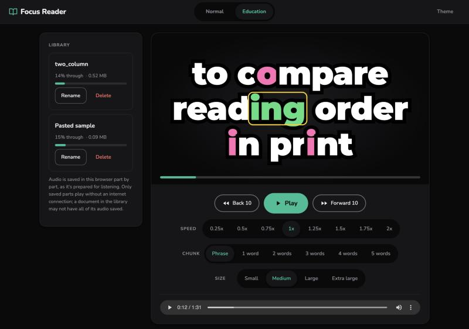

# Focus Reader

Focus Reader reads a document out loud and shows only the word or few words being spoken, in large caption-style text on an otherwise empty screen. It's for people who lose their place or their focus when a page is full of text, even while listening along to an audiobook: instead of following the voice across a page, you only ever see what is being said right now. You can paste text, upload a `.txt` file or upload a PDF (including two-column research papers), and every document is saved in a library in your browser with its own reading position. [WHAT-IT-DOES.md](WHAT-IT-DOES.md) describes the features in plain language.

## Screenshots and demo

A paused document in Education mode, with the library on the left. The page follows the system's light or dark setting, or the Theme button.

| Light | Dark |
| --- | --- |
|  |  |

<!-- A short demo recording will be added here. -->

## How it works

One small server (`backend/server.py`, Python and Flask) delivers both the page and its API from the same address, `http://127.0.0.1:5001/` when run locally, so the whole app can also be hosted at a single public URL:

- **The page** (`frontend/index.html`, plain HTML, CSS and JavaScript, no build step) shows the captions, the controls and the library. It plays the audio and keeps the caption in step with it using each word's start and end time. It talks to the server through relative paths (`/synthesize`, `/extract-pdf`), so it works at whatever address the server has.
- **The server** also does what a web page can't do on its own:
  - **Speech with word timestamps:** it turns text into speech with [edge-tts](https://github.com/rany2/edge-tts), which uses Microsoft's online speech service, and records when every word starts and ends. The browser matches those words to the words of your text.
  - **The PDF pipeline:** it extracts a PDF's text in reading order (columns are read one after the other), tags each word with its page, removes headers, footers and page numbers, rejoins words hyphenated across lines, optionally removes citations, and leaves equations out of the spoken text while recording where they are.

**Audio in sections.** A long document is spoken in sections of about 450 words, ending at a paragraph or sentence end where possible. Reading starts as soon as the first section is ready, and the next one is prepared while you listen, one request at a time. Jumping to a distant page prepares only the section you jump to.

**The library.** Each document, its reading position and every audio section already made are saved in the browser's IndexedDB, so reopening a document resumes at the same word and saved sections play without the server or a connection. The server deletes the audio files it generates after an hour; the browser keeps its own copy.

**Education mode.** A tab at the top switches between Normal and Education. Education mode marks up the caption for reading practice: short vowels in pink, welded sounds (-ang, -ing, -ank...) in green, and a thin yellow box around prefixes and suffixes. These come from phonics rules and an English word list (`frontend/words.txt`), not a pronunciation dictionary, so unusual words can be marked wrongly.

**Equations.** When playback reaches an equation in a PDF, it pauses, shows the equation's text for five seconds, and continues.

## Setup

You need:

- **Python 3.10 or newer** (developed and tested with Python 3.14; the code uses 3.10 syntax)
- **A desktop browser** (developed and tested with Google Chrome)
- **An internet connection** to generate new audio

Get the code and install the server's requirements in a virtual environment:

```bash
git clone <this repository's URL> focus-reader
cd focus-reader/backend
python3 -m venv venv
source venv/bin/activate          # Windows: venv\Scripts\activate
pip install -r requirements.txt
python check_env.py               # confirms the packages are installed
```

Start the server (leave it running). It serves both the page and the API:

```bash
python server.py                  # from focus-reader/backend, with the venv active
```

Open <http://127.0.0.1:5001/> in your browser, paste some text and press **Start**. Open the page through the server like this, not by opening the HTML file directly: from a file (`file://`) the page can't reach the server.

The server uses port 5001 (port 5000 is taken by AirPlay on macOS).

### Keys

- **Space:** play / pause (pausing brings the controls back)
- **Left / Right arrow:** back / forward 10 seconds

## Running with Docker

The same app runs in a container, the way it's hosted on Hugging Face Spaces: one [gunicorn](https://gunicorn.org) server on port 7860 serves the page and the API.

```bash
cd focus-reader
docker build -t focus-reader .
docker run --rm -p 7860:7860 focus-reader
```

Then open <http://localhost:7860/>. Generated audio lives inside the container and is deleted after an hour, as on a local run; each reader's library stays in their own browser.

To keep a public copy from being misused, the server refuses text over 10,000 characters per request (the page sends sections of a few thousand at most) and PDFs over 25 MB, with a message saying why.

## Running the tests

```bash
cd focus-reader
backend/venv/bin/python -m pip install -r backend/requirements-dev.txt   # adds pytest
./run-tests.sh
```

This runs three parts and exits non-zero if anything fails:

- **Python** (`tests/python/`, pytest): word timings from the speech engine, PDF extraction on the small sample PDFs in `tests/fixtures/` (reading order, page numbers, header and footer removal, rejoined hyphenated words, equations), the server's cleanup of old audio, and the server delivering the page (only files from `frontend/`, never anything outside it) with relative audio links. One test calls the real speech service and is skipped when it can't be reached.
- **Node** (`tests/node/`, Node 22 or newer): matching the speech engine's words to the text on deliberately messy input.
- **Browser** (`tests/browser/`, needs Google Chrome): runs the real page in headless Chrome with a fake speech service and silent audio, and checks the library, section playback, ranges, migration of older libraries, and that pauses, seeks and document switches always win over background work. Set `CHROME_PATH` to use another Chrome or Chromium.

`run-tests.sh` is a POSIX shell script; on Windows, run it from Git Bash or WSL, or run the three commands inside it one by one.

## Known limitations

- **Equations aren't read aloud.** Playback pauses and shows them as text instead, and that text is exactly what the PDF contains, which is garbled for some PDFs (doubled letters, for example). Math inside a sentence is left out of the audio without a pause.
- **One English voice** (`en-US-AriaNeural`).
- **The speech service is unofficial.** The hosted version, like a local one, uses Microsoft's online speech service through edge-tts. It's free but unofficial: Microsoft hasn't published it for this use, so it may stop working or be rate-limited at any time (it has already needed an edge-tts update once).
- **New audio needs the internet.** The speech is generated by Microsoft's online speech service through edge-tts, so the text you're reading is sent to that service. Audio already saved in your library plays offline.
- **No tap-to-pause on touch devices.** Pausing and bringing the controls back uses the keyboard (Space) or the on-screen buttons when they're visible.
- **No accounts and no sync.** The library lives in one browser on one device; clearing the browser's site data deletes it.
- **PDFs:** scanned PDFs without a text layer can't be read (run them through OCR first). Figure and table captions and footnotes are read where they sit on the page, so they can interrupt a sentence, and tables are read row by row.

## Credits

The word list in `frontend/words.txt` comes from the en_US Hunspell dictionary in [SCOWL](http://wordlist.aspell.net), copyright Kevin Atkinson and others; its copyright and permission notices are in `frontend/words-LICENSE.txt`.

## How it was built

This project was built with AI coding tools: the code, tests and documentation were written with Claude Code, following a step-by-step build plan, and each step was reviewed and tested in a real browser and against real PDFs as it was built. The automated test suite was added at the end and checked by deliberately breaking the code to confirm each test fails when it should.
